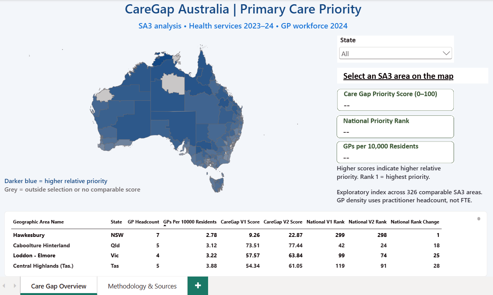
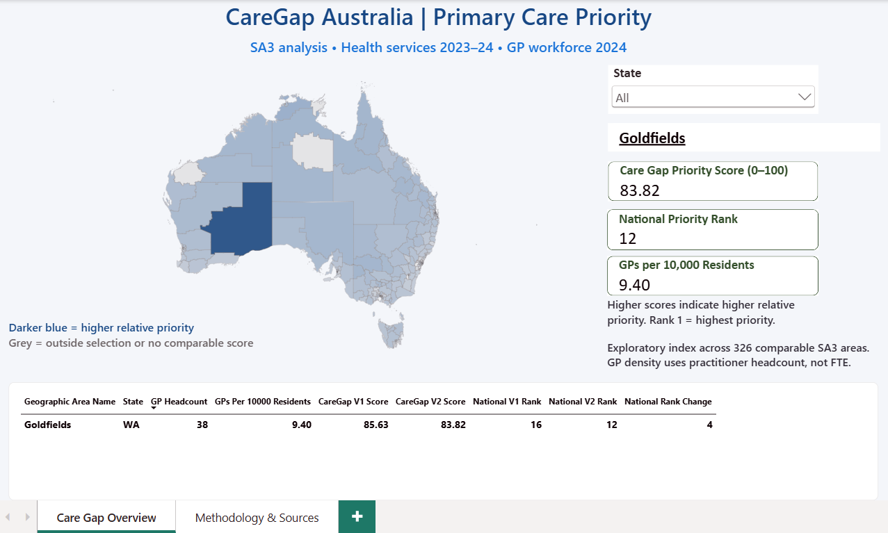
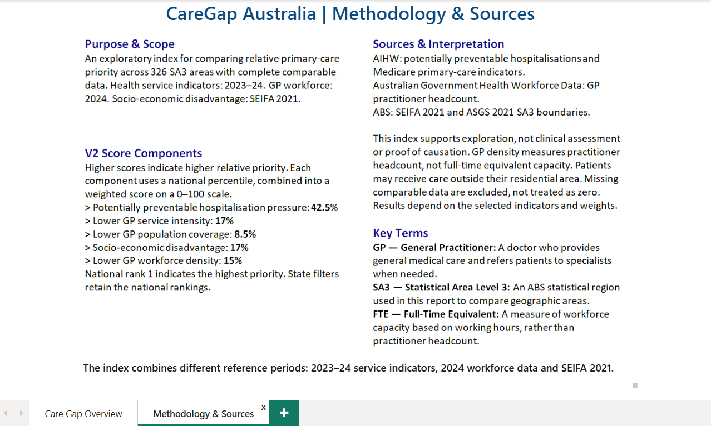

# CareGap Australia

**Primary Care Access & Preventable Hospitalisation Intelligence**

CareGap Australia is a healthcare business intelligence portfolio project that brings Australian government data into a SQL Server warehouse for Power BI analysis. It compares potentially preventable hospitalisations, Medicare-funded GP service use, socioeconomic disadvantage and GP workforce availability across local areas.

The aim is to help analysts identify areas that warrant further investigation and explain which indicators contribute to their relative priority. The scores are exploratory: they do not establish that inadequate primary care caused a hospitalisation or prove an unmet need for services.

## Dashboard preview

The report compares 326 SA3 areas with comparable data in the displayed project snapshot. It combines FY 2023–24 service indicators, 2024 GP workforce headcounts and SEIFA 2021. Selecting an area shows its V2 score, national rank and GP density.

### National overview



### Selected area: Goldfields, Western Australia



The captured Goldfields selection displays a V2 score of **83.82**, national rank **12**, and **9.40 GP practitioners per 10,000 residents**. These values illustrate the report output; the score is exploratory and is not a clinical risk estimate.

### Methodology and sources



The report explains the five score components, reference periods and interpretation limits. For the detailed geographic matching caveat and component-specific comparison cohorts, see the methodology document below.

## Project documentation

| Document | Contents |
|---|---|
| [Architecture](docs/architecture.md) | Warehouse layers, fact grains, SQL execution order and deployment status |
| [Methodology](docs/methodology.md) | Cohort selection, indicator definitions, weights, sensitivity scenarios and limitations |
| [Data sources](docs/data_sources.md) | Official sources, snapshot periods, input filenames and CSV preparation requirements |
| [Data dictionary](docs/data_dictionary.md) | Warehouse column types, availability statuses and reporting fields |

## Questions the project explores

- Where are potentially preventable hospitalisation rates relatively high?
- How do GP service use and population coverage vary between areas?
- How does socioeconomic disadvantage relate to an area's indicator profile?
- Which areas have relatively fewer GP practitioners per resident?
- How do priority rankings change when the weighting assumptions change?

## Data sources and project snapshots

| Dataset | Official source | Period used in this project | Role |
|---|---|---|---|
| Potentially preventable hospitalisations (PPH) | [Australian Institute of Health and Welfare — HPF 76](https://www.aihw.gov.au/reports/primary-health-care/potentially-preventable-hospitalisations-2017-2024/data) | 2017–18 to 2023–24 | Hospitalisations, rates, bed days and length of stay |
| Medicare-subsidised services | [Australian Institute of Health and Welfare — PHC 19](https://www.aihw.gov.au/reports/primary-health-care/medicare-subsidised-gp-allied-health-specialist/data) | 2017–18 to 2024–25 | Service use, patient coverage, benefits and provider fees |
| Socio-Economic Indexes for Areas (SEIFA) | [Australian Bureau of Statistics — SEIFA](https://www.abs.gov.au/statistics/people/people-and-communities/socio-economic-indexes-areas-seifa-australia/latest-release) | 2021 Census snapshot | SA3 population distributions, including the Index of Relative Socio-economic Disadvantage (IRSD) |
| Medical workforce | [Australian Government — Health Workforce Data Tool](https://www.hwd.health.gov.au/datatool/index.html) | Calendar year 2024 | General practice practitioner headcounts by SA3 |

These are the snapshots used by the project, rather than a claim that every source is the latest available release. The analysis uses published aggregate data, not patient-level clinical records.

**GP** means general practitioner. **SA3** means Statistical Area Level 3. **PHN** means Primary Health Network.

## Architecture and implementation

The SQL warehouse separates source ingestion, analytical modelling and reporting:

| Layer | SQL schema | Responsibility |
|---|---|---|
| Staging | `stg` | Raw imports, typed cleaning and deduplication views |
| Warehouse | `dw` | Shared dimensions and five fact tables |
| Reporting | `rpt` | Analytical views, priority rankings and dashboard outputs |
| Presentation | Power BI | Interactive exploration of the reporting views |

The five facts cover PPH, Medicare services, SEIFA score distributions, SA3 IRSD summaries and workforce headcounts. Shared dimensions support geography, time, demographic groups, conditions, services, measures and data availability.

Implementation features include publication-status tracking, source-file audit fields where available, unique grain indexes, foreign keys, check constraints and columnstore indexes for the PPH and Medicare facts. ETL stages reconcile source and fact row counts to detect records lost through dimension joins.

The geographic comparison views focus on non-aggregate SA3 areas. PHN-level PPH analysis supports investigation of specific conditions where the source provides that detail.

## Indicators and priority scoring

The reporting layer provides PPH counts and rates, bed days, GP services per 100 people, GP population coverage, disadvantaged-population shares and GP practitioners per 10,000 residents.

The latest priority view in this package, `rpt.vwCareGapPriorityV2`, combines five relative indicators:

| Component | Direction associated with higher priority | Weight |
|---|---|---:|
| PPH pressure | Higher age-standardised PPH rate | 42.5% |
| GP service use | Lower services per 100 people | 17.0% |
| GP population coverage | Lower reported coverage | 8.5% |
| Socioeconomic disadvantage | Higher IRSD lowest-decile population share | 17.0% |
| GP workforce availability | Fewer GP practitioners per 10,000 residents | 15.0% |

The SQL combines percentile-based indicators into a score on a 0–100 scale. Weights are project assumptions, not clinically validated thresholds. Contribution views explain each component's role in the score.

V2 compares financial year 2023–24 with the 2024 workforce snapshot and 2021 SEIFA data. Earlier views provide V1 rankings and four V1 weight scenarios. The sensitivity scenarios do **not** test the additional V2 workforce component.

## Interpretation limits

- PPH categories and individual conditions can overlap. Use the reported **Total PPH**; do not reconstruct it by summing categories.
- Demographic groups, service hierarchies and geographic totals can overlap. Select a consistent analytical grain before aggregation.
- Rates and percentages are not additive. Preserve the distinction between percentage points and decimal fractions.
- Lower GP use or headcount may reflect factors beyond access. Practitioner headcount does not measure full-time equivalent capacity, appointment availability or actual travel time.
- SEIFA describes areas; it does not establish an individual resident's socioeconomic circumstances.
- Calendar years, financial years and Census snapshots differ. Matching geographic codes alone does not establish equivalent boundaries; the workforce source was labelled ASGS 2023, and boundary equivalence requires further verification.
- Published-data exclusions affect the comparison cohort and relative rankings. A lower relative priority does not mean an area has no healthcare needs.

## Repository contents and status

| Path | Contents | Status |
|---|---|---|
| `README.md` | Project overview and SQL setup | Prepared |
| `sql/` | 26 SQL files: schema, reporting views, imports, ETL and validation | Prepared; static checks completed |
| `docs/` | Architecture, methodology, source notes and data dictionary | Prepared |
| `screenshots/` | National overview, selected-area example and methodology page | Included |

The exported schema contains 29 tables, 18 views and one import procedure. The reconstructed package has been checked for insert-column compatibility, required columns, file includes and basic dependency order. A complete clean installation and ETL run has **not** been verified on SQL Server for this GitHub package.

Raw datasets, prepared CSVs, Power BI files and DAX definitions are not included in the current package. The SEIFA and workforce loaders require project-prepared CSVs; converting the original source workbooks or exports into those CSVs is not automated here.

## Run the SQL package

Requirements: SQL Server 2022, `sqlcmd`, and source files readable by the SQL Server service account. SQL Server Management Studio can also run the scripts with **SQLCMD Mode** enabled; the `:r` include paths must resolve to the `sql` folder.

1. Place the extracted `sql` folder alongside this README.
2. Edit `sql/00_config.sql`: choose an unused database name and set `SourceRoot` to the server-accessible data folder.
3. Arrange source files using the paths documented in `sql/10_run_etl.sql` and `sql/15_import_medicare.sql`. Inspect the prepared CSV requirements before loading.
4. Open a terminal in the `sql` folder and run the schema installer, then ETL:

```bat
sqlcmd -S localhost -E -b -f 65001 -i 00_install.sql
sqlcmd -S localhost -E -b -f 65001 -i 10_run_etl.sql
```

Replace `localhost` with the actual SQL Server instance if needed. The commands use Windows authentication; `-f 65001` reads the UTF-8 SQL scripts. Individual CSV encodings are configured separately in the import statements.

The installer creates an empty database and refuses an existing target. ETL is designed for a fresh build: several stages reject nonempty targets, and Medicare raw files cannot be imported twice under the same filename. The workforce stage replaces only its selected year/category inside a transaction. Use a separate build database and inspect any failed stage before resuming.

## Portfolio focus

This project demonstrates translating a healthcare question into a dimensional model, preserving source limitations during ETL, defining interpretable indicators and preparing a reporting layer for Power BI. It is an independent analytical portfolio project, with no claimed endorsement by the data providers.

## Author

**S. Hossein Alaeinejad**
